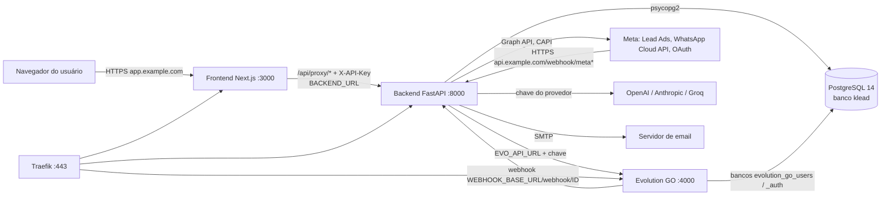

# Arquitetura do KLEAD-CLIENT

Mapa da estrutura do aplicativo, das ferramentas usadas e de como os componentes se conectam. Revisado em 2026-11-02 a partir dos arquivos desta versão. Endereços sob `example.com` são fictícios.

## Visão geral

O KLEAD é um CRM com atendimento por WhatsApp e qualificação de leads com IA. São três camadas da aplicação e um conjunto de serviços externos:

| Camada | Tecnologia | Pasta | Porta interna |
|---|---|---|---|
| Painel (interface) | Next.js 16 + React 19 + Tailwind 4 (Node 20+) | `dashboard/frontend` | 3000 |
| API | FastAPI + Uvicorn (Python 3.12+) | `dashboard/backend` | 8000 |
| Banco | PostgreSQL 14 | stack `stacks/postgres.yml` ou container local | 5432 |
| WhatsApp por QR Code (opcional) | Evolution GO, compilado do repositório oficial | `stacks/evolution-go.yml`, `scripts/build-evolution-go.sh` | 4000 |
| HTTPS e roteamento (VPS) | Traefik v3 + Let's Encrypt | `stacks/traefik.yml` | 80/443 |
| Orquestração (VPS) | Docker Engine + Swarm (um manager) | `docker-stack.yml`, `stacks/` | — |
| Administração Docker (VPS, auxiliar) | Portainer CE | `stacks/portainer.yml` | 9000 |

## Como as peças se conectam



Regras que mantêm essa ligação segura e funcionando:

- **O navegador nunca fala direto com o backend.** Toda chamada passa por `dashboard/frontend/app/api/proxy/[...path]/route.ts`, que adiciona `X-API-Key` (= `DASHBOARD_SECRET`) e o token do usuário (cookie `klead_token`). A `API_KEY` fica só no servidor do frontend.
- **`dashboard/frontend/proxy.ts`** (middleware do Next.js) bloqueia páginas sem login e restringe telas por função (superadmin, admin, gerente, sdr).
- **Endereços internos e públicos são diferentes.** `BACKEND_URL`, `WEBHOOK_BASE_URL` e `EVO_MEDIA_BASE` usam o nome interno do serviço (`http://klead_backend:8000` na VPS; `http://localhost:8000` localmente). `PUBLIC_WEBHOOK_BASE` é a URL pública que a Meta precisa alcançar.
- **Estado em memória, réplica única.** O backend carrega instâncias e conversas do PostgreSQL para a memória na inicialização. Por isso roda com `replicas: 1`. Se o PostgreSQL está configurado e indisponível, o backend **aborta a inicialização** (fail-fast) para não sobrescrever dados reais com um estado vazio.
- **Credenciais cifradas.** Segredos de integrações gravados no banco são cifrados com chave derivada de `DASHBOARD_SECRET`. Perder essa chave impede ler as credenciais restauradas de um backup.

## Estrutura de pastas

```text
KLEAD-CLIENT/
├── README.md, INSTALL.md          Ponto de entrada e passo a passo VPS
├── install.py                     Launcher no computador: envia o pacote por SSH e inicia o wizard na VPS
├── install.sh                     Wizard na VPS: Docker/Swarm, rede, Traefik, Postgres, Evolution GO, app, backup
├── docker-stack.yml               Stack Swarm do backend + frontend (labels do Traefik)
├── docker-compose.yml             Compose legado (depende de rede externa e túnel; não é ambiente local completo)
├── .env.example                   Lista de variáveis, sem valores reais
├── stacks/                        traefik.yml, postgres.yml, evolution-go.yml, portainer.yml
├── patches/                       Patches aplicados ao Evolution GO oficial no build
├── scripts/
│   ├── verificar-pc.ps1           Verifica o PC Windows (local ou VPS) e oferece instalar o que falta
│   ├── verificar-pc.sh            O mesmo para Linux/macOS
│   ├── verificar-vps.sh           Inventário da VPS e pré-requisitos do wizard
│   ├── update.sh                  Atualiza backend/frontend na VPS com rollback de imagem
│   ├── pg-backup.sh               Dump diário dos bancos (timer systemd)
│   ├── build-evolution-go*.sh     Build do Evolution GO na revisão fixada
│   ├── fix-webhook.py             Corrige o webhook do Evolution GO (altera e reinicia o serviço)
│   ├── install-env.py             Gera/atualiza o arquivo privado de configuração
│   ├── audit-secrets.py           Procura padrões de credenciais nos arquivos versionados
│   └── deploy.py                  Legado; fora do fluxo indicado
├── dashboard/
│   ├── backend/
│   │   ├── main.py                App FastAPI, ciclo de vida, /health, agendador
│   │   ├── core/                  Estado em memória, SSE, rate limit, segurança
│   │   ├── routers/               auth, instances, conversations, crm, webhook, meta_oauth,
│   │   │                          media, assignments, inbox_polls, admin, billing, guide
│   │   ├── services/              Regras de negócio e integrações (ver tabela abaixo)
│   │   ├── utils/                 Leitura de planilhas/PDF/DOCX, limpeza de contatos
│   │   └── tests/                 Testes pytest
│   └── frontend/
│       ├── app/                   Páginas: login, instances, inbox, crm, roleta, supervisao,
│       │                          users, settings/ai, settings/meta, admin, planos, legais
│       ├── app/api/proxy/         Proxy server-side para o backend
│       ├── components/, lib/      Layout, cabeçalho, cliente da API, autenticação
│       └── proxy.ts               Controle de acesso por rota
└── docs/                          Guias (ver índice no README)
```

## Módulos do backend

| Área | Arquivos principais | O que faz |
|---|---|---|
| Autenticação e usuários | `routers/auth.py`, `services/auth_service.py` | Login, JWT em cookie, 2FA (TOTP), convites, recuperação por email, funções e planos |
| Instâncias | `routers/instances.py`, `services/instances_pg_service.py` | Cada instância é um canal de WhatsApp com sua configuração de IA |
| Conversas e Inbox | `routers/conversations.py`, `services/conversation_pg_service.py`, `core/sse.py` | Histórico, envio, atualização em tempo real (SSE), assumir/devolver à IA |
| CRM | `routers/crm.py`, `services/crm_pg_service.py`, `crm_service.py` | Contatos, etapas, observações, origem do lead |
| Webhooks de entrada | `routers/webhook.py` | `/webhook/{instance_id}` (Evolution GO), `/webhook/meta`, `/webhook/meta-forms`, `/webhook/meta-leads`, `/webhook/meta-whatsapp` |
| IA | `services/responder_service.py`, `openai_service.py`, `patterns_service.py`, `kb_embedding_service.py`, `transcription_service.py` | Resposta e qualificação, base de conhecimento, padrões aprendidos, transcrição de áudio |
| WhatsApp | `services/evolution_service.py`, `outbound_routing.py`, `media_service.py` | Envio pelo Evolution GO ou Cloud API, QR Code, mídias |
| Meta | `routers/meta_oauth.py`, `services/meta_*` | OAuth (`/meta/connect`, `/meta/callback`), Lead Ads, Conversions API, análise de anúncios |
| Distribuição de leads | `routers/assignments.py`, `services/assignment_service.py` | Roleta entre atendentes |
| Campanhas e enquetes | `services/campaign_service.py`, `routers/inbox_polls.py` | Disparos e enquetes no Inbox |
| Administração | `routers/admin.py`, `services/audit_log_service.py` | Painel multi-cliente e trilha de auditoria |
| Cobrança | `routers/billing.py`, `services/stripe_service.py` | Stripe da operação do fornecedor; não é requisito para compradores |

As tabelas são criadas pelo próprio backend (`CREATE TABLE IF NOT EXISTS`) quando cada serviço inicia. O **banco** `klead` precisa existir antes; na VPS o wizard o cria, e localmente você o cria uma vez (ver [instalação local](instalacao/local.md)).

## Variáveis de configuração

Referência completa dos nomes em [`.env.example`](../.env.example). Os valores reais ficam fora do Git: na VPS em `/etc/klead/klead.env` (modo 600); localmente em `dashboard/backend/.env` e `dashboard/frontend/.env.local`, ambos ignorados pelo Git.

| Grupo | Variáveis | Obrigatória |
|---|---|---|
| Chave mestra | `DASHBOARD_SECRET` (também é a `API_KEY` do frontend) | Sim — o backend não inicia sem ela |
| Primeiro acesso | `SUPERADMIN_EMAIL`, `SUPERADMIN_PASSWORD` | Sim, para existir um login |
| Banco | `EVO_PG_HOST`, `EVO_PG_PORT`, `EVO_PG_USER`, `EVO_PG_PASSWORD`, `INST_PG_DB`, `CRM_PG_DB` (padrão `klead`) | Sim para persistência; sem senha o backend entra em modo dev sem dados |
| Endereços | `KLEAD_APP_URL`, `ALLOWED_ORIGINS`, `PUBLIC_WEBHOOK_BASE`, `WEBHOOK_BASE_URL`, `EVO_MEDIA_BASE` | Sim |
| Cookies | `COOKIE_SECURE` (`true` com HTTPS, `false` em `http://localhost`) | Sim |
| Frontend | `BACKEND_URL`, `API_KEY` | Sim |
| Evolution GO | `EVO_API_URL`, `EVO_GLOBAL_API_KEY`, `EVO_PG_DB` | Se usar WhatsApp por QR Code |
| IA | `OPENAI_API_KEY`, `ANTHROPIC_API_KEY`, `GROQ_API_KEY`, `KLEAD_LLM_PROVIDER`, `KLEAD_LLM_MODEL`, `EMBEDDING_OPENAI_KEY` | Opcional (também configurável no painel) |
| Email | `SMTP_HOST`, `SMTP_PORT`, `SMTP_USER`, `SMTP_PASSWORD` | Para convites e recuperação de senha |
| Meta | `META_APP_SECRET`, `META_OAUTH_APP_ID`, `META_OAUTH_APP_SECRET`, `META_OAUTH_REDIRECT_URI` | Se usar Meta |
| VPS/Traefik | `DOMAIN_*`, `ACME_EMAIL`, `TRAEFIK_NETWORK`, `TRAEFIK_ENTRYPOINT`, `TRAEFIK_CERTRESOLVER` | Somente na VPS |
| Monitoramento | `SENTRY_DSN`, `SENTRY_ENVIRONMENT` | Opcional |

Chaves gravadas pelo painel na tabela `klead_config` têm prioridade sobre o ambiente quando o backend inicia.

## Os dois caminhos de execução

| | Local (computador) | VPS |
|---|---|---|
| Para que serve | Conhecer, testar e desenvolver | Atender clientes 24h com domínio próprio |
| Como roda | PostgreSQL em container Docker; backend e frontend direto no Python/Node | Tudo em containers Docker Swarm, atrás do Traefik com HTTPS |
| Endereços | `http://localhost:3000` (painel), `http://localhost:8000` (API) | `https://app.example.com`, `https://api.example.com`, `https://go.example.com` |
| Webhooks externos (Meta) | Não chegam sem um túnel HTTPS (ex.: Cloudflare Tunnel) | Funcionam pelo domínio público |
| Automação | Procedimento manual guiado; ainda sem instalador local | Wizard `install.py` / `install.sh` |
| Guia | [Instalação local](instalacao/local.md) | [Instalação VPS](instalacao/vps.md) e [INSTALL.md](../INSTALL.md) |

Antes de qualquer um, rode a [verificação de ferramentas](instalacao/verificacao.md).

## Limitações conhecidas

Detalhadas em [preparação da distribuição](distribuicao/preparacao.md) e na [auditoria](security/distribution-audit-2026-11-01.md). As principais:

- `/health` responde HTTP 200 mesmo com `postgres=false`. Leia o conteúdo da resposta.
- Uma conexão no router CRM ainda usa a porta 5432 fixa.
- O OAuth da Meta pode falhar com `csrf_invalido` em domínios de compradores (cookie específico do domínio do fornecedor).
- A troca do nome interno `klead` por instalação é manual (ver [INSTALL.md](../INSTALL.md#nome-do-aplicativo-instrução-obrigatória-para-a-ia-instaladora)).
- Não há instalador local nem homologação completa do wizard VPS em servidor limpo.
