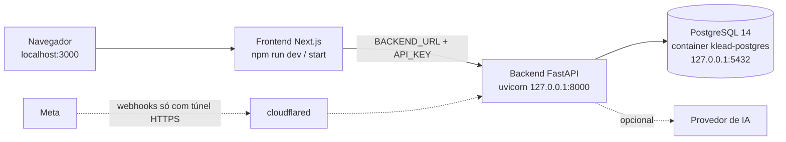

# Instalação local (no computador)

Caminho para rodar o KLEAD-CLIENT no próprio computador, para conhecer, testar ou desenvolver. Painel em `http://localhost:3000`, API em `http://localhost:8000`.

> **Situação desta versão:** não existe instalador local automático. Este é um **procedimento manual**: PostgreSQL em container Docker, backend e frontend rodando direto no Python e no Node. Ele usa os mesmos comandos de validação do projeto (`pytest`, `npm run build`), mas ainda não foi homologado como oferta para compradores. Para atender clientes 24h com domínio próprio, use a [instalação em VPS](vps.md).

Instalar localmente não significa funcionar offline: IA, WhatsApp e Meta dependem de internet. Com o computador desligado ou suspenso, o atendimento para.

## Como fica a instalação local



| Arquivo criado por você | Conteúdo | Versionado? |
|---|---|---|
| `dashboard/backend/.env` | Configuração e senhas do backend | Não (ignorado pelo Git) |
| `dashboard/frontend/.env.local` | `BACKEND_URL` e `API_KEY` | Não (ignorado pelo Git) |
| Volume Docker `klead_pg_data` | Dados do PostgreSQL | Não |
| `dashboard/backend/data/` | Base de conhecimento, backups e arquivos do app | Não |

## Passo 0 — Verificar o computador

```powershell
powershell -ExecutionPolicy Bypass -File scripts\verificar-pc.ps1 -Modo local
```

Em Linux/macOS: `bash scripts/verificar-pc.sh --modo local`. Resolva os itens `[FALTA]`; acrescente `-Instalar` (ou `--instalar`) para instalar cada um com confirmação. Detalhes em [verificação](verificacao.md).

Você precisa de Git, Python 3.12+, Node.js 20.9+, Docker em execução e as portas 3000, 8000 e 5432 livres.

**Porta 5432:** se já houver outro PostgreSQL nessa porta (por exemplo, um PostgreSQL 14+ instalado no WSL ou no sistema), use a opção B do passo 1 ou pare aquele serviço. Não troque a porta: uma conexão do CRM ainda usa 5432 fixo.

## Passo 1 — Banco de dados

Escolha uma senha forte para o banco e guarde-a; ela vai no passo 2.

**Opção A — container Docker (recomendado):**

```bash
docker volume create klead_pg_data
docker run -d --name klead-postgres --restart unless-stopped \
  -e POSTGRES_PASSWORD=SENHA_DO_BANCO \
  -p 127.0.0.1:5432:5432 \
  -v klead_pg_data:/var/lib/postgresql/data \
  postgres:14
docker exec klead-postgres pg_isready -U postgres     # repita até "accepting connections"
docker exec klead-postgres createdb -U postgres klead
```

No PowerShell, troque `\` no fim das linhas por `` ` `` ou escreva o `docker run` em uma linha só. `127.0.0.1:` impede que o banco fique acessível pela rede.

**Opção B — PostgreSQL 14+ já instalado:** crie um usuário e um banco próprios, sem usar os de outros projetos:

```bash
sudo -u postgres psql -c "CREATE USER klead WITH PASSWORD 'SENHA_DO_BANCO';"
sudo -u postgres createdb -O klead klead
```

Nesse caso use `EVO_PG_USER=klead` no passo 2. As tabelas são criadas pelo backend na primeira execução.

## Passo 2 — Configuração do backend

Gere a chave mestra:

```bash
python -c "import secrets; print(secrets.token_urlsafe(48))"
```

Crie `dashboard/backend/.env` com seus valores (os nomes estão em [arquitetura](../arquitetura.md#variáveis-de-configuração)):

```dotenv
DASHBOARD_SECRET=CHAVE_GERADA_ACIMA
SUPERADMIN_EMAIL=admin@example.com
SUPERADMIN_PASSWORD=SENHA_DO_PRIMEIRO_LOGIN

EVO_PG_HOST=127.0.0.1
EVO_PG_PORT=5432
EVO_PG_USER=postgres
EVO_PG_PASSWORD=SENHA_DO_BANCO
INST_PG_DB=klead
CRM_PG_DB=klead

COOKIE_SECURE=false
KLEAD_APP_URL=http://localhost:3000
ALLOWED_ORIGINS=http://localhost:3000
PUBLIC_WEBHOOK_BASE=http://localhost:8000
WEBHOOK_BASE_URL=http://localhost:8000
EVO_MEDIA_BASE=http://localhost:8000

# Opcionais: também podem ser configurados depois pelo painel
OPENAI_API_KEY=
ANTHROPIC_API_KEY=
GROQ_API_KEY=
```

Guarde `DASHBOARD_SECRET` em local seguro: sem ela não é possível ler as credenciais gravadas no banco. Ela **não** é a senha de login.

## Passo 3 — Backend

Windows (PowerShell):

```powershell
cd dashboard\backend
python -m venv .venv
.\.venv\Scripts\Activate.ps1
python -m pip install -r requirements.txt
uvicorn main:app --host 127.0.0.1 --port 8000
```

Linux/macOS:

```bash
cd dashboard/backend
python3 -m venv .venv
source .venv/bin/activate
python -m pip install -r requirements.txt
uvicorn main:app --host 127.0.0.1 --port 8000
```

Deixe esse terminal aberto. Em outro terminal, confira:

```bash
curl http://127.0.0.1:8000/health
```

A resposta precisa conter `"postgres": true`. HTTP 200 com `"postgres": false` significa que o banco não está sendo usado e os dados **não** serão salvos. Se o PostgreSQL estiver configurado e inacessível, o backend se recusa a iniciar (comportamento intencional): confira o passo 1 e a senha.

## Passo 4 — Frontend

Crie `dashboard/frontend/.env.local`:

```dotenv
BACKEND_URL=http://127.0.0.1:8000
API_KEY=MESMA_CHAVE_DO_DASHBOARD_SECRET
```

Em outro terminal:

```bash
cd dashboard/frontend
npm ci
npm run dev
```

`npm run dev` é o modo de desenvolvimento. Para usar como produção no computador: `npm run build` e depois `npm start`.

## Passo 5 — Primeiro acesso

Abra `http://localhost:3000`, entre com `SUPERADMIN_EMAIL` e `SUPERADMIN_PASSWORD` e conclua a troca de senha. Siga [primeiro acesso](../uso/primeiro-acesso.md) para criar a instância, configurar a IA e conferir que os dados permanecem depois de reiniciar o backend.

## WhatsApp e Meta no computador

| Recurso | No computador |
|---|---|
| IA, CRM, Inbox, base de conhecimento | Funcionam com o passo a passo acima |
| WhatsApp Cloud API e formulários Meta | A Meta precisa alcançar a API por HTTPS. Exige túnel, por exemplo `cloudflared tunnel --url http://localhost:8000` (URL temporária). Coloque a URL do túnel em `PUBLIC_WEBHOOK_BASE` e reinicie o backend |
| WhatsApp por QR Code (Evolution GO) | **Não coberto por este guia.** O Evolution GO deste pacote é construído e executado pela stack da VPS. Use o caminho VPS |
| Email (convites e recuperação) | Configure `SMTP_*` no `.env` |

O OAuth da Meta ainda tem uma limitação de cookie em domínios de compradores; veja [integrações](../integracoes/configuracao.md#limitação-atual-de-oauth-e-domínios).

## Uso diário

| Ação | Comando |
|---|---|
| Iniciar | `docker start klead-postgres`; depois o passo 3 (`uvicorn ...`) e o passo 4 (`npm run dev` ou `npm start`), cada um em um terminal |
| Parar | `Ctrl+C` nos terminais do backend e do frontend; `docker stop klead-postgres` |
| Backup do banco | `docker exec klead-postgres pg_dump -U postgres -Fc -f /tmp/klead.dump klead` e `docker cp klead-postgres:/tmp/klead.dump ./klead-AAAA-MM-DD.dump` |
| Restaurar | `docker cp ARQUIVO.dump klead-postgres:/tmp/restore.dump` e `docker exec klead-postgres pg_restore -U postgres -d klead --clean --if-exists /tmp/restore.dump` (com o backend parado) |
| Atualizar o código | `git pull --ff-only`; `pip install -r requirements.txt` no venv; `npm ci` e reinicie os dois processos |
| Validar | `python -m pytest tests` em `dashboard/backend`; `npm run lint` e `npm run build` em `dashboard/frontend` |

O `docker cp` evita redirecionar o dump com `>`, que no Windows PowerShell corrompe arquivos binários. Guarde os dumps e a pasta `dashboard/backend/data/` fora do repositório, junto com uma cópia protegida de `DASHBOARD_SECRET`. Não há agendamento de backup local neste pacote.

Remover tudo: pare os processos, `docker rm -f klead-postgres` e, **só se quiser apagar os dados**, `docker volume rm klead_pg_data`.

## O que ainda falta para um instalador local

Requisitos para transformar este procedimento em instalador para compradores:

- Instalação limpa em cada sistema anunciado (Windows/WSL, Linux, macOS), com credenciais próprias.
- Geração automática e preservação da configuração privada nas reexecuções.
- Evolution GO local ou orientação homologada para WhatsApp por QR Code.
- Publicação HTTPS opcional para callbacks externos.
- Iniciar/parar como serviço, backup agendado, atualização, restauração e desinstalação preservando dados.
- Login, persistência após reinício, mensagens e IA testados.

Até lá, consulte também [requisitos](requisitos.md) e [pendências de distribuição](../distribuicao/preparacao.md).
