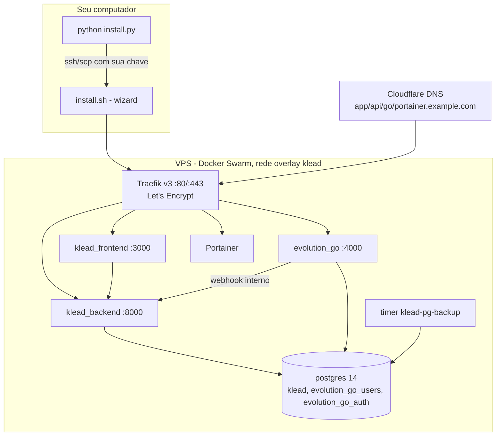

# Instalação em VPS

Caminho para colocar o KLEAD-CLIENT em um servidor com domínio próprio e HTTPS, atendendo 24h. O wizard está implementado; a homologação completa em VPS limpa, com infraestrutura existente e em ARM64 ainda está pendente. Referência detalhada de cada pergunta do wizard, configuração privada, backup e rollback: [INSTALL.md](../../INSTALL.md).

**Computador** é onde ficam o editor, o código de trabalho e sua chave SSH privada. **VPS** é o servidor onde a aplicação funciona. **GitHub** guarda o código versionado, nunca as credenciais da instalação.

## Como fica a instalação na VPS



## Roteiro

| Etapa | Onde | Resultado |
|---|---|---|
| 1. Verificar o computador | PC | `ssh`, `scp`, Python e chave SSH presentes |
| 2. Preparar o código | PC | Pasta aberta no editor e repositório privado próprio |
| 3. Criar a VPS e acessar por SSH | Provedor + PC | Login por chave funcionando |
| 4. Configurar domínio e DNS | Registrador + Cloudflare | Registros A apontando para a VPS |
| 5. Diagnosticar a VPS | VPS | Inventário do que existe e plano de reaproveitamento |
| 6. Definir o nome da instalação | PC | Cópia personalizada (opcional, manual) |
| 7. Rodar o wizard | PC ou VPS | Serviços no ar com HTTPS |
| 8. Validar e primeiro acesso | Navegador | Login, WhatsApp, IA e formulários testados |
| 9. Backup e atualização | VPS | Dumps conferidos e procedimento de atualização |

## 1. Verificar o computador

```powershell
powershell -ExecutionPolicy Bypass -File scripts\verificar-pc.ps1 -Modo vps
```

Em Linux/macOS: `bash scripts/verificar-pc.sh --modo vps`. O computador precisa apenas de Python 3 e do cliente OpenSSH (`ssh` e `scp`). Docker, Node e PostgreSQL **não** são necessários no PC para este caminho: todos os builds acontecem na VPS. Veja [verificação](verificacao.md).

## 2. Preparar o código no computador

Extraia o pacote em uma pasta própria e use **Abrir pasta** no editor (VS Code, Antigravity ou outro). Confirme que a pasta contém `README.md`, `install.py`, `install.sh`, `docker-stack.yml`, `dashboard/` e `stacks/`.

Crie um repositório **privado na sua conta** do GitHub. Antes de enviar, revise o que vai no commit:

```bash
git status --short
git diff --cached --name-only
```

Exclua do commit arquivos `.env` com valores reais, chaves privadas, dumps, backups, logs, dados de clientes e configurações pessoais do editor. Uma regra no `.gitignore` não remove arquivos que já foram versionados. Repositório privado não é lugar para senhas. Não coloque tokens na URL do repositório.

## 3. Criar a VPS e acessar por chave SSH

Crie uma VPS **Ubuntu 22.04/24.04 ou Debian 12**, amd64 (ARM64 aceito, sem homologação), em um provedor como Oracle ou Contabo. Os builds de Next.js e Go consomem mais memória do que manter os serviços rodando: sem um mínimo homologado, prefira 4 GB de RAM ou configure swap.

Use uma chave SSH sua. Para criar uma dedicada, fora da pasta do projeto e sem sobrescrever outra:

```bash
ssh-keygen -t ed25519 -f ~/.ssh/klead_vps
```

- **Chave pública** (`.pub`): cadastre na criação da VPS.
- **Chave privada**: fica no seu computador. Não copie para a VPS, para o GitHub, para o pacote ou para o chat da IA.

Teste o acesso no terminal **do computador**:

```bash
ssh -i CAMINHO_DA_CHAVE_PRIVADA USUARIO_DA_VPS@IP_DA_VPS
```

Use o usuário informado pelo provedor (nem sempre é `root`) e confira a identidade do servidor na primeira conexão. O instalador pede só o **caminho** da chave; quem a usa é o OpenSSH do seu computador.

## 4. Configurar domínio e Cloudflare

1. Registre um domínio sob seu controle e adicione-o à Cloudflare.
2. No registrador, configure os nameservers fornecidos pela Cloudflare.
3. Crie registros **A** apontando para o IP público da VPS:

| Exemplo ilustrativo | Serviço |
|---|---|
| `app.example.com` | Painel (login e planos podem usar o mesmo) |
| `api.example.com` | API, webhooks e callbacks |
| `go.example.com` | Evolution GO |
| `portainer.example.com` | Administração Docker |

Mantenha em **DNS only** até os certificados serem emitidos. Remova registros **AAAA** que não apontem para esta VPS. Libere 80/443 e a porta SSH no firewall do sistema **e** no painel do provedor (na Oracle: Security Lists/NSGs; o instalador não altera o painel). Ao ativar o proxy da Cloudflare depois, use **Full (strict)**.

## 5. Diagnosticar a VPS antes de instalar

Envie ou clone o pacote na VPS (ou faça isso depois, pelo `install.py`) e rode, **na VPS**:

```bash
bash scripts/verificar-vps.sh app.example.com api.example.com go.example.com portainer.example.com
```

O verificador só lê: sistema, recursos, portas, firewall, Docker/Swarm, stacks, redes, volumes, instalação existente e DNS. Os comandos manuais equivalentes estão em [verificação](verificacao.md#vps).

| Situação encontrada | Conduta |
|---|---|
| VPS vazia | O wizard instala Docker, rede, Traefik, banco, Evolution GO, app, Portainer e backup |
| Docker compatível em funcionamento | Reaproveitar; não reinstalar |
| Docker antigo ou com falha | Explicar a incompatibilidade e planejar a correção considerando os outros serviços |
| Traefik ou outro proxy existente | Conferir portas, rede e configuração; não instalar outro na mesma porta |
| PostgreSQL existente | Confirmar host, porta 5432, credenciais e acesso pela rede da aplicação |
| Evolution GO existente | Confirmar versão, URL, chave e compatibilidade |
| Instalação parcial | Recuperar configuração e preservar volumes e segredos antes de retomar |

Encontrar um serviço pelo nome não comprova compatibilidade. Containers Compose e proxies fora do Swarm não são convertidos automaticamente. Não remova containers, redes ou volumes para contornar conflitos.

## 6. Definir o nome da instalação (opcional)

Os arquivos usam o nome interno `klead` em caminhos, serviços e imagens. A personalização é manual e segue a seção [Nome do aplicativo](../../INSTALL.md#nome-do-aplicativo-instrução-obrigatória-para-a-ia-instaladora) do INSTALL. Faça só na cópia destinada à nova instalação e nunca renomeie uma instalação que já está em uso. Sem a troca, a instalação funciona com os nomes do pacote.

## 7. Rodar o wizard

No computador, na pasta do projeto:

```bash
python install.py
```

Ou, já conectado à VPS com o pacote na pasta: `sudo bash install.sh`. São duas entradas para o mesmo fluxo. Pelo verificador, `bash scripts/verificar-vps.sh --instalar` também oferece instalar os pré-requisitos e iniciar o wizard, pedindo confirmação em cada etapa.

O wizard pergunta: acesso SSH (só no `install.py`), rede overlay, dados do Postgres, domínios, email do SSL, email e senha do superadmin, senha do Portainer, segredos internos (Enter gera aleatórios) e, opcionalmente, chaves de IA, SMTP e App Meta/OAuth. A lista completa e o que é instalado estão no [INSTALL.md](../../INSTALL.md#uma-entrada-para-a-instalação-completa).

**Atenção:** o wizard não tem modo de simulação e começa a preparar dependências antes de terminar as perguntas. Ele pode instalar pacotes, alterar o firewall e inicializar o Swarm. Execute depois de revisar o diagnóstico.

A configuração privada fica em `/etc/klead/klead.env` (modo 600). Reexecuções preservam os valores. Nunca regenere `DASHBOARD_SECRET` de uma instalação existente.

## 8. Validar e primeiro acesso

O wizard confere a conexão ao banco e as respostas HTTP/HTTPS do backend, do painel, do Evolution GO (`/server/ok`) e do Portainer. Isso não comprova login nem persistência. O `/health` pode responder HTTP 200 com `"postgres": false`: leia o conteúdo.

```bash
curl -s https://api.example.com/health
sudo docker stack services klead
```

Depois siga [primeiro acesso](../uso/primeiro-acesso.md): login com `SUPERADMIN_EMAIL`/`SUPERADMIN_PASSWORD`, criação da instância, QR Code do WhatsApp, IA, formulários Meta e conferência dos dados após um reinício controlado. Configure as contas externas pelo guia de [integrações](../integracoes/configuracao.md).

## 9. Backup e atualização

O wizard instala o timer `klead-pg-backup` (diário às 03:00, retenção local de 14 dias em `/var/backups/klead-postgres`). Ele cobre os bancos, não volumes nem a configuração privada. Veja [backup e restauração](../operacao/backup-restauracao.md).

Para atualizar, envie a nova versão do código à VPS e rode `sudo bash scripts/update.sh all` (ou `backend`/`frontend`), com `--rollback` para voltar à imagem anterior. Detalhes e limites em [atualização](../operacao/atualizacao.md).

Em caso de problema, consulte [diagnóstico](../operacao/diagnostico.md).

## Orientação para a IA no editor

A IA que conduzir esta instalação deve pedir permissão antes de cada etapa que instala ou altera algo e seguir esta ordem: verificador do PC, perguntar o domínio ou nome do aplicativo (seção "Nome do aplicativo" do INSTALL), verificador da VPS somente leitura, plano do que será reaproveitado/criado/corrigido, e só então o wizard. Texto sugerido para iniciar, sem informar segredos:

> Leia o README, docs/instalacao/vps.md e o INSTALL.md e analise os arquivos desta versão antes de executar. Primeiro, pergunte-me qual domínio ou nome usarei para o meu aplicativo. Rode os verificadores do PC e da VPS em modo leitura e mostre o que falta. Apresente o que será reaproveitado, criado ou corrigido e peça minha permissão antes de cada instalação ou alteração. Nunca peça ou copie minha chave SSH privada, envie credenciais ao GitHub, regenere a chave mestra de uma instalação existente ou remova dados para contornar conflitos. Ao concluir, diferencie verificações de infraestrutura dos testes reais de login, WhatsApp e Meta.
